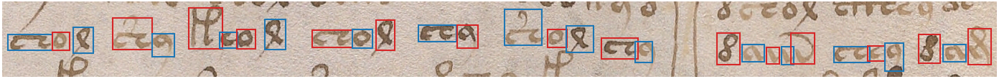
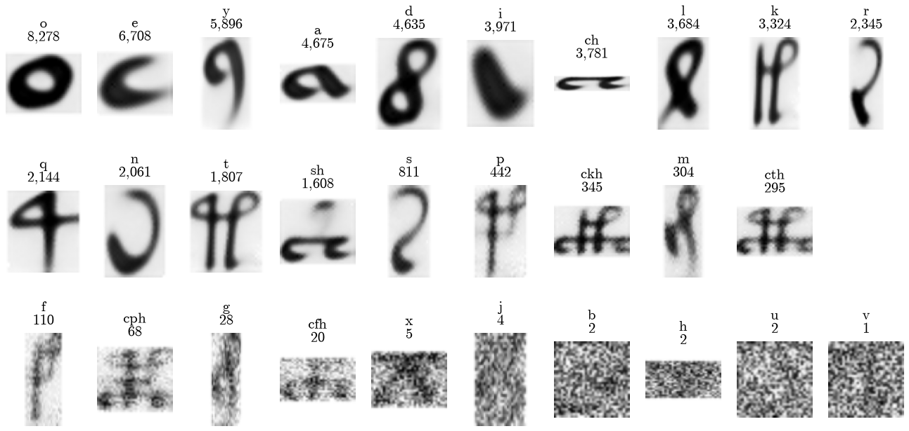
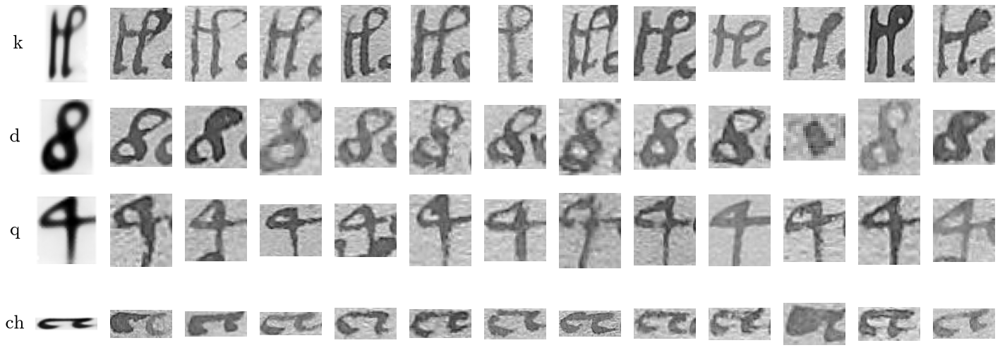
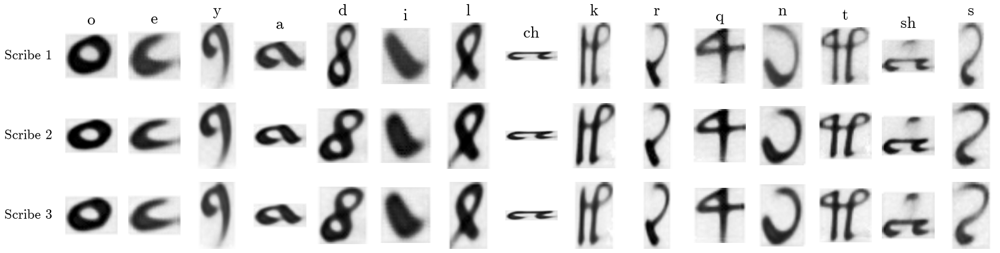

# voynich-letters

Statistical work on the Voynich manuscript uses typed transcriptions, mainly René Zandbergen and Gabriel Landini's
[ZL3b-n.txt](https://www.voynich.nu/data/ZL3b-n.txt), written in EVA, the standard alphabet for the manuscript's
letters. These transcriptions say which letters a line holds but not where each one sits on the page. As
[Rozanova and Temerev (2026)](https://arxiv.org/abs/2608.17096) put it, "Treating the three observed categories as
letters, words, and uniform word spaces builds an untested decipherment into the data."

This repository gives the position of every letter on 2,173 text lines, each with a cut-out picture of the letter, its
letter in ZL and a model's own reading. Every k (or any other letter) can now be pulled out and its shape, size and
spacing studied side by side.



## Methods

[Kraken](https://github.com/mittagessen/kraken) 7.1.1 finds the text lines on each page scan, and the word boxes of
[voynich-glyph-embeddings](https://github.com/LaineyLouiseWard/voynich-glyph-embeddings) match each line to its line in
ZL. The letter model, morphology4metrology ([Vlachou-Efstathiou, Baena, Stutzmann and Aubry 2026](https://arxiv.org/abs/2606.09446),
ICDAR 2026), learns from each line's text alone. It was trained on most pages and tested on the rest. It does three jobs
here.

- It draws a box around each letter. ZL's letters are matched to these boxes from left to right, choosing the match
  the model finds most likely, so every ZL letter gets one box. This builds the dataset.
- It reads each letter. Its reading is used only to measure how well it works and to mark where it disagrees with ZL.
- It learns an average picture of every letter, so you can see what it takes each symbol to look like.

voynich-glyph-embeddings found only k and n, with a detector trained on Torsten Timm's hand-drawn boxes, and cleaned
each letter with the SBB ink model and a U-Net. This model needs no hand-drawn boxes and places every letter.

## What the model learned



Letters with a few hundred training examples or more get a clear picture. The bottom row holds those with fewer than
200. Of these, f, cph, g and cfh come out blurred, and the rarest (x, j, b, h, u, v) stay as noise. They are rare in ZL
itself (x appears 41 times in the whole transcription).



## How well it reads

On pages kept out of training, the model's reading differs from ZL's on 5.1% of letters. It does worse on Currier's
style A (11.4%), which had fewer training lines, than on style B (4.5%). For comparison, a second human transcription
differs from ZL on 1.4% of the same letters: Takeshi Takahashi's complete EVA transcription, published in Jorge
Stolfi's 1999 file of Voynich transcriptions.

## Three scribes

The letter pictures were trained further on each of Davis's (2020) three main scribes in turn. Shown are the 15 letters
with at least 200 training examples from each scribe, stretched to that scribe's average box size.



All three scribes give every letter the same shape; only d differs, narrower and taller for scribe 1. Scribe 1's
pictures are softer because that scribe has the fewest training letters (12,615, against 18,897 and 21,704).

## Data

`make letters` writes these to `data/letters/`.

- `letters.csv` has one row per letter, with its page, line, ZL's letter, the model's letter and its probability, its
  box on the page scan in pixels, whether its page was used in training, and its scribe (Davis 2020), Currier style and
  section.
- `crops/` holds each letter at its true size, and `square/` each letter on a 224-pixel square.
- `extra.csv` lists boxes where the model sees a letter that ZL does not have.

There are 82,272 letters. At 97.7% of them the model's own reading matches ZL's letter (96.5% on pages kept out of
training). ZL marks some letters as unreadable or gives two possible readings. Lines with such letters, or with a rare
mark (an apostrophe), are left out, so 2,173 of the 2,824 lines found on the 166 pages are covered.

## Getting started

Conda environment `voynich-letters` (`requirements.txt`):

```bash
conda install -c nvidia cuda-nvcc=13.0 cuda-cudart-dev=13.0 cuda-cccl=13.0   # once, to compile the model's GPU code
make dataset        # Kraken lines matched to ZL, split into training and test pages
make model          # the model's code (with our changes) and its starting weights
```

Training needs a large GPU. Ours ran on UCD's Sonic cluster, with `cluster/sync.sh`, then `bash cluster/setup_env.sh`
once and `sbatch --time=04:00:00 --export=ALL,RUN=reference cluster/train.sbatch` in `~/scratch/voynich-letters`. With
`data/runs/reference` copied back, run (the scribe pictures come from `cluster/scribes.sbatch`, also on Sonic)

```bash
make reading        # the model, ZL and Takahashi compared on the test pages (results/)
make letters        # every letter placed and cut out
make figures        # the figures above
```

## Structure

- `scripts/` holds the pipeline, its tests and our changes to the model's code (`morphology4metrology.patch`).
- `config/` holds file paths, thresholds and the model's settings.
- `cluster/` holds the jobs for training on a cluster.
- `results/` holds the reading comparisons, line by line and letter by letter.
- `figures/` holds the figures above.

## Licence

Code is [MIT](LICENSE). The page scans belong to the [Beinecke Rare Book & Manuscript Library](https://collections.library.yale.edu/catalog/2002046)
and are not in this repository; the figures are cut from them. ZL3b-n.txt and IT2a-n.txt (Takahashi's transcription)
come from [voynich.nu](https://www.voynich.nu/data/), and `results/` quotes their text of the test lines. The
model's code has no licence and is not included. `scripts/morphology4metrology.patch` holds only our changes to it.
